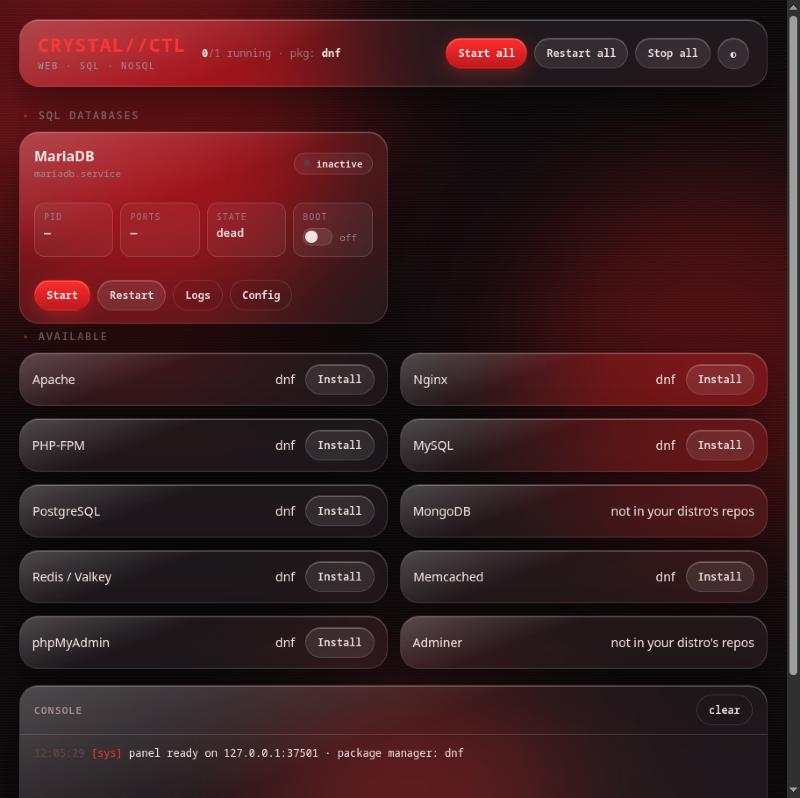
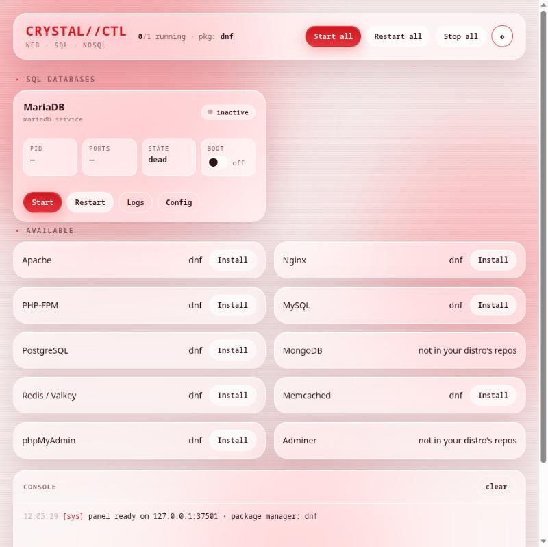

# crystalctl — your local stack, under glass

<div align="center">


**One panel and one command for your whole local stack: web servers, SQL and NoSQL databases.**

<sub>Formerly Lamp_ControlPanel. Running `./install.sh` again removes the old `lamp` commands.</sub>



</div>

## What it manages

| Group | Services | Install with `crystalctl install` |
|---|---|---|
| Web | Apache, Nginx, PHP-FPM | apt · dnf · pacman · zypper |
| SQL | MariaDB, MySQL, PostgreSQL | MySQL: apt and dnf only (not in Arch/openSUSE repos) |
| NoSQL & cache | MongoDB, Redis / Valkey, Memcached | MongoDB is manage-only: no distro ships it |
| Admin panels | phpMyAdmin, Adminer | Adminer: apt only |

It only shows what you have installed, and it finds it by its real systemd unit (`apache2` or `httpd`,
`php8.3-fpm`, `redis-server` or `valkey`…). Aliases such as Fedora's `mysql.service → mariadb` are not
counted twice.

## Features

- **Liquid-glass panel** with light and dark themes in black and red; it remembers your choice.
- **Start, stop, restart** each service or all of them, and switch **start at boot** on or off.
- **Live state**: running or not, systemd sub-state, main PID and which default ports are listening.
- **Logs** from the journal, and one click to open each service's config file.
- **Installs** services through your package manager, including the first-run steps some distros need
  (`postgresql-setup --initdb` on Fedora, `initdb` on Arch, `mariadb-install-db` on Arch).
- **Safe by design**: the panel listens on `127.0.0.1` only and every request needs a secret token that
  changes on each launch, so a web page cannot drive it. Root actions go through `pkexec`, which shows
  your desktop's password prompt.
- **No dependencies** beyond Python 3.8+ and systemd.

## Install

```bash
git clone https://github.com/taddheotorres/crystalctl.git
cd crystalctl
./install.sh
```

The installer copies `crystalctl` and `crystalctl-gui` to `/usr/local/bin`, the shared code to
`/usr/local/lib/crystalctl`, the panel to `/usr/local/share/crystalctl`, and adds a desktop launcher.

## Usage

### Panel

Open **crystalctl** from your app menu, or run `crystalctl gui`. It opens as an app window in
Chromium, Chrome, Brave or Edge if you have one, otherwise in your default browser. It closes itself
about 45 seconds after you close the window.



### Terminal

```text
crystalctl status                  live state, boot, PID and listening ports
crystalctl list                    every supported service and how to install it
crystalctl start|stop|restart [s]  act on the named services, or all installed ones
crystalctl enable|disable <s>      start at boot (and now) / stop and remove from boot
crystalctl logs <s> [lines]        recent journal entries
crystalctl install <s> [-y]        install with apt, dnf, pacman or zypper
crystalctl gui                     open the graphical panel
crystalctl web | crystalctl dir    open http://localhost | the web root
crystalctl db                      open phpMyAdmin
```

```text
$ crystalctl status
CRYSTAL//CTL web · sql · nosql

SERVICE         UNIT            STATE       BOOT   PID      PORTS
Apache          httpd           ● running   yes    1204     80, 443
PostgreSQL      postgresql      ● running   no     1388     5432
Redis / Valkey  valkey          ○ inactive  no     -        -
```

## Notes

- Ports are matched against each service's default ports. Without root, Linux does not say which
  process owns a socket, so a service on a custom port shows no port.
- Reading the journal may need your user in the `systemd-journal` group; `crystalctl logs` runs it through sudo.
- MariaDB and MySQL usually cannot be installed side by side; your package manager will refuse.

## Development

```bash
python3 -m unittest discover -s tests   # no root and no services needed
bin/crystalctl-gui --no-window                # prints the panel URL instead of opening a window
```

## Uninstall

```bash
./uninstall.sh
```

## License

MIT
